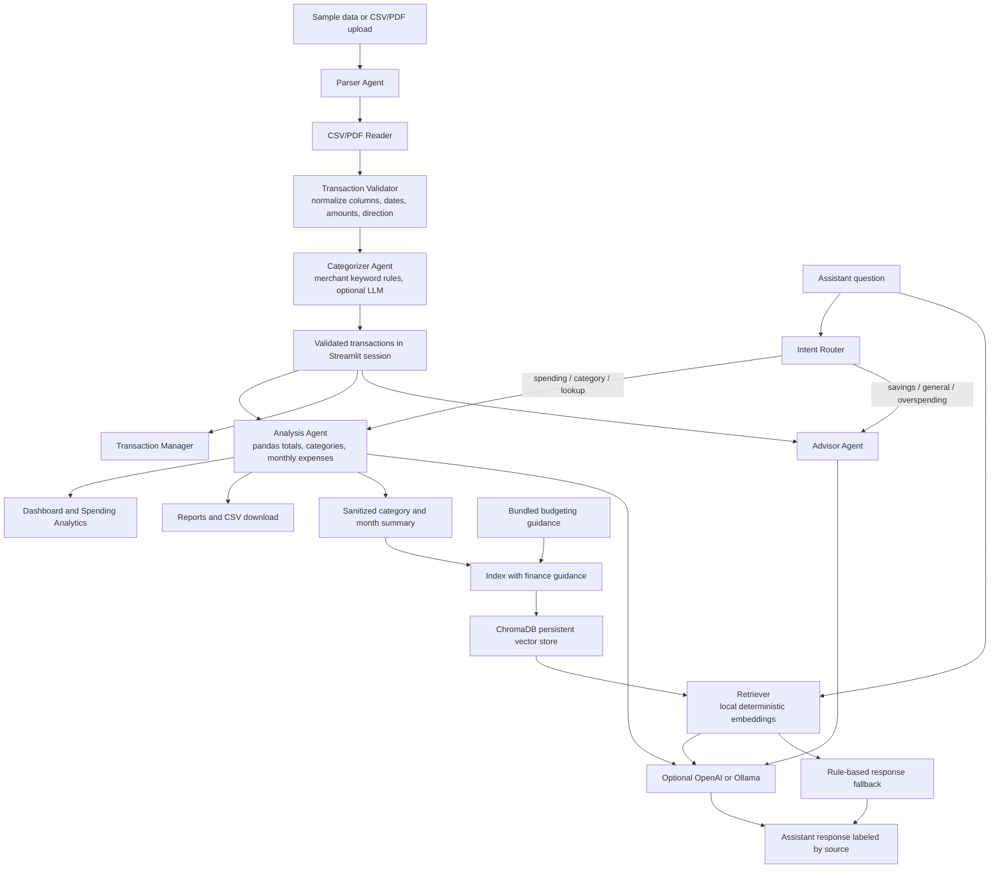

# Architecture

The application keeps the existing agent-oriented layout. Streamlit orchestrates the parser/categorizer pipeline on upload, calls deterministic pandas analysis for dashboard metrics, and routes assistant questions to analysis or advice. ChromaDB retrieval provides context to the assistant; an optional hosted or local chat model generates natural-language answers.

## Components and responsibilities

- **Parser Agent** (`agents/parser_agent.py`): selects the CSV or PDF reader, applies standardization, and exposes validation counts.
- **Validators** (`utils/validators.py`): normalize common bank/UPI field names, parse currency amounts without converting malformed values to zero, infer transaction direction from transaction type/debit/credit/signed amount, and flag invalid rows.
- **Categorizer Agent** (`agents/categorizer_agent.py`): classifies merchant descriptions using keyword rules and can optionally ask the configured LLM to classify remaining `Others`.
- **Analysis Agent** (`agents/analysis_agent.py`): computes exact totals, category expenses, monthly expenses, largest expenses, and average monthly spending using pandas. Invalid rows are excluded.
- **Advisor Agent** (`agents/advisor_agent.py`): reports the leading expense category and provides general, explainable spending suggestions; it can optionally append LLM advice.
- **Intent Router** (`core/intent_router.py`): uses keyword rules first, with optional LLM classification, and selects analysis or advisor flow.
- **RAG** (`rag/`): indexes bundled finance guidance plus aggregate category/month summaries. Deterministic local hashing embeddings avoid model downloads. Raw transaction descriptions are not indexed. Retrieval context is supplied to the optional LLM and shown with the rule-based fallback.
- **Streamlit UI** (`app.py`): exposes Dashboard, Upload Statement, Transaction Manager, Spending Analytics, AI Finance Assistant, and Reports.

## Data and provider boundaries

Uploaded transaction data is parsed locally and held in Streamlit session state. The vector store receives finance guidance and sanitized aggregate totals rather than transaction descriptions. If OpenAI or Ollama is configured, the assistant question, transaction summary, and retrieved context are passed to that provider. Without a configured provider—or if an answer request fails—the assistant returns a clearly labeled rule-based response.

The PDF reader extracts selectable text; it does not OCR scans or guarantee compatibility with arbitrary statement layouts. Review flagged transactions and extracted values before using any report.
